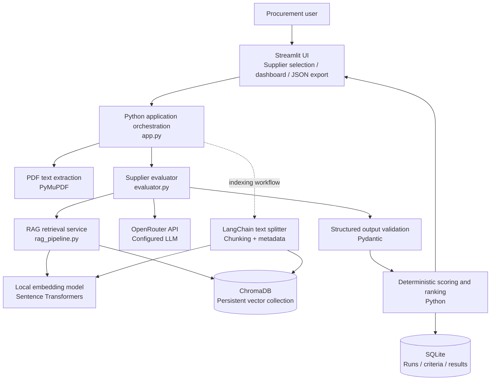

# ProcureAI Solution Architecture

## Scope

This diagram describes the current local prototype: Streamlit is the presentation layer; Python coordinates PDF extraction, RAG retrieval, LLM evaluation, deterministic scoring, and persistence. ChromaDB and Sentence Transformers run locally. OpenRouter is an external model API.

## Component architecture

## Component responsibilities

| Component | Responsibility | Boundary |
|---|---|---|
| Streamlit | Supplier selection, progress, results, charts, export | UI only; does not own scoring rules |
| PDF extraction | Extract page text and page numbers | Does not judge proposal quality |
| LangChain text splitter | Split text into overlapping chunks and retain metadata | This is the confirmed LangChain use; not proof of LangGraph or full chain orchestration |
| Sentence Transformers | Convert text/query into vectors locally | Embeddings only; no LLM reasoning |
| ChromaDB | Persist chunks/vectors and retrieve semantically similar evidence | Local vector store |
| OpenRouter | Run configured LLM inference | External service; proposal evidence sent in request must be considered sensitive |
| Pydantic | Validate LLM response shape | Structural validation does not guarantee factual correctness |
| Python scoring | Calculate weighted scores and rankings | Deterministic business logic |
| SQLite | Persist criteria, run metadata, and supplier results | Local relational persistence |

## Important design notes

- The vector index must be built from the proposal files before retrieval can work.
- Supplier identifiers used as Chroma metadata filters must match identifiers in the index; display names should not silently replace stable IDs.
- Local embedding inference and remote LLM inference have different performance profiles. Measure them separately.
- Keep API keys in environment variables or a local secrets file excluded from Git.
- Current architecture is not yet a LangGraph workflow unless that code is added and tested.
