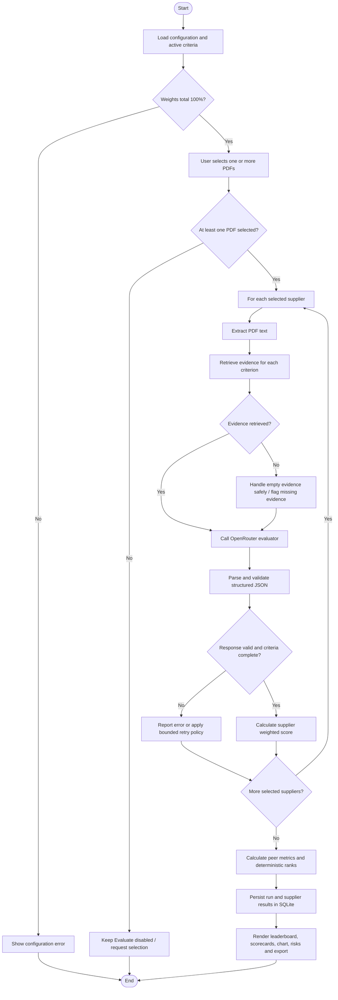

# ProcureAI Control-Flow Diagram (CFD)

A control-flow diagram shows **the order of execution and decision points**. This is different from a DFD, which focuses on data movement.

## Evaluation control flow

## Runtime observability recommendations

Add structured timings around these stages before optimizing:

1. PDF text extraction.
2. Query embedding.
3. ChromaDB retrieval.
4. OpenRouter request/response (usually a likely latency source).
5. Schema validation and scoring.
6. SQLite persistence and dashboard rendering.

Log elapsed time, selected supplier ID, number of retrieved chunks, model identifier, response status, and token usage if available. Never log API keys or full confidential proposal content. Parallel execution, caching, retries, and LangGraph nodes should be added deliberately and covered by tests.
