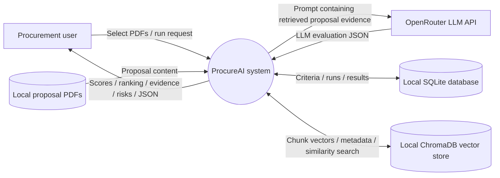
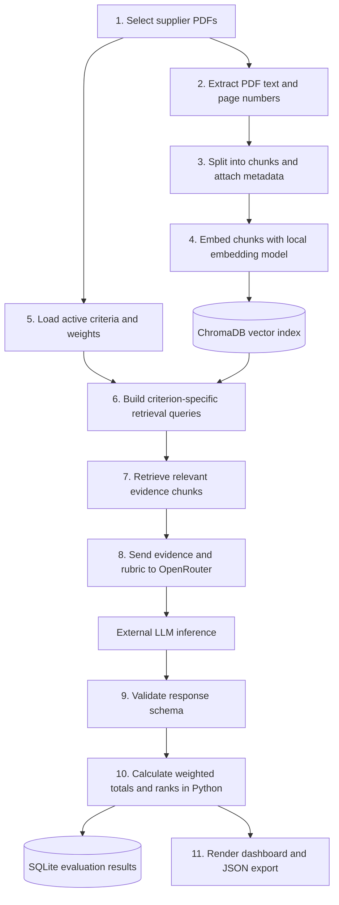

# ProcureAI Data-Flow Diagrams (DFD)

A DFD describes **where data comes from, how it is transformed, where it is stored, and which external systems receive it**. These diagrams document the current prototype.

## DFD Level 0 — Context diagram

## DFD Level 1 — Evaluation data flow

## Data inventory and trust boundaries

| Data | Origin | Processing/storage | External transmission? |
|---|---|---|---|
| Proposal PDF/text | Local sample files or user upload | Extracted and chunked in Python | Retrieved evidence may be sent to OpenRouter for evaluation |
| Chunk metadata | Filename, supplier identifier, page/chunk information | Stored with vectors in ChromaDB | May accompany retrieved evidence if included in the prompt |
| Embeddings | Local embedding model | ChromaDB | No, when the local embedding model is used as configured |
| Evaluation JSON | OpenRouter response | Validated, scored, persisted in SQLite | Received from OpenRouter |
| Scores/rankings | Deterministic Python calculation | SQLite and Streamlit | Not necessarily transmitted unless separately configured |
| API key | Developer environment | Read by application at runtime | Sent as authentication to OpenRouter; never expose in UI/logs/repository |

## Privacy note

The current prototype uses synthetic data. Before using real supplier proposals, obtain organizational approval for sending retrieved proposal content to the selected external model provider and review data retention, confidentiality, and contractual terms. A public GitHub repository must not contain real proposals or credentials.
